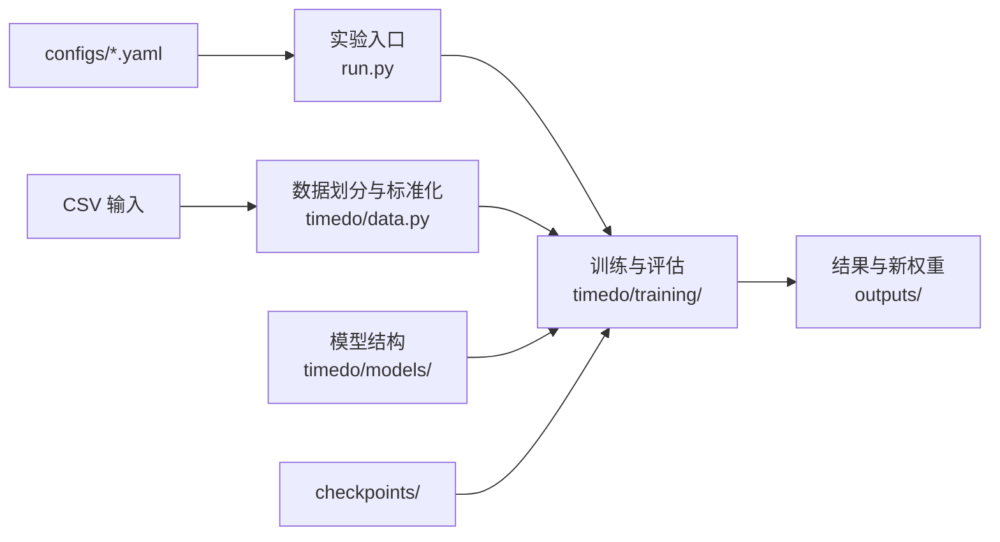

# TimeDO

TimeDO 是一个面向多变量时间序列预测的研究代码库。项目把输入数据、实验参数、模型结构、训练过程、预训练权重和运行产物分别管理，保证每个实验都能通过数据集与预测长度定位。

## 项目结构

```text
TimeDO-master/
├── configs/                 数据集 YAML：CSV 文件名、模型和训练参数
├── data/                    可选的本地输入 CSV；数据协议说明
├── checkpoints/
│   ├── pretrained/          可直接评估的发布权重
│   ├── initializations/     ETTh1/ETTh2 微调初始化权重
│   ├── manifest.json        权重路径、SHA256、来源和选模说明
│   └── experiment_records.json  合并后的训练与评估记录
├── outputs/                 运行时自动生成的指标、日志和新权重（已忽略）
├── scripts/                 权重检查、调参与发布工具
├── tests/                   数据协议、模型组件和工作流测试
├── timedo/
│   ├── models/              Householder 编码器、状态转移、解码器和总模型
│   ├── training/            训练/评估引擎、损失函数和指标
│   ├── data.py              CSV 读取、划分、标准化和 DataLoader
│   ├── config.py            模型参数类型与校验
│   └── presets.py           YAML 解析与运行配置组合
└── run.py                   统一实验入口
```

`configs/<dataset>.yaml` 是数据集与预测长度的参数入口；`run.py` 负责解析配置和选择权重，`timedo/data.py` 负责 CSV 校验、时间切分和标准化，`timedo/models/` 定义模型结构，`timedo/training/` 实现训练、评估、损失和指标。发布权重与初始化权重分别放在 `checkpoints/pretrained/` 和 `checkpoints/initializations/`。训练、评估和调参产生的文件统一写入 `outputs/`，不与源码、输入数据或发布权重混放。



## 输入数据

本工作区默认从项目上一级的 `Datasets/` 读取 CSV，例如 `../Datasets/ETTh1.csv`、`../Datasets/ETTm1.csv`、`../Datasets/exchange_rate.csv` 和 `../Datasets/Solar.csv`。支持的数据集与文件名由 `configs/<dataset>.yaml` 的 `data_file` 字段绑定。也可以通过 `--data_root` 或 `TIMEDO_DATA_ROOT` 指定其他目录。特征列顺序按数据集协议确定，标准化只在训练切分上拟合。

ETTh1/ETTh2 使用小时级 ETT 固定时间切分；ETTm1/ETTm2 使用分钟级 ETT 固定时间切分。Exchange、Solar、Electricity、Traffic 和 Weather 使用 CSV 原始行序的 70/10/20 切分。ETT、Exchange 和 Solar 要求日期唯一且递增；Electricity、Traffic 和 Weather 允许重复或乱序日期标签，并按原始行序构造窗口。各数据集的日期列、通道顺序和 CSV 文件名见 [data/README.md](data/README.md)。

## 模型与训练流程

`timedo/models/forecaster.py` 将输入窗口 `(batch, time, channels)` 转为周期相位剖面，再交给共享或逐通道的 `DeepHouseholderEncoder` 做逐层正交降维。默认 `d1` 路径先通过 `LatentTransition` 预测浅层潜状态，再沿同一编码层级继续降维，最后由线性解码头还原预测序列。训练时可用未来窗口构造停止梯度的潜状态目标；模型预测分支仍只读取历史输入，损失由 `timedo/training/losses.py` 计算。`latent_mode=rank` 将转移放在最深状态，`latent_mode=none` 则关闭转移和潜状态对齐项。

`run.py` 根据数据集和预测长度读取 YAML，`evaluate` 从 `checkpoints/pretrained/` 载入发布权重，`refine` 默认从 `checkpoints/initializations/` 载入初始化权重，`train` 从随机初始化开始。训练和评估由 `timedo/training/engine.py` 执行，结果、日志与新权重写入 `outputs/`。

## 安装

建议使用 Python 3.10 或更新版本。先按本机 CPU/CUDA 环境安装合适的 PyTorch，再安装项目依赖：

```bash
python -m pip install torch
python -m pip install -e .
```

## 运行

显示某个任务的实际配置：

```bash
python run.py --show_config --dataset ETTm1 --pred_len 96
```

评估已发布权重：

```bash
python run.py --mode evaluate --dataset ETTh1 --pred_len 96 192 336 720 --device cuda
```

训练新模型：

```bash
python run.py --mode train --dataset ETTm1 --pred_len 96 --device cuda
```

默认数据目录为 `../Datasets/`；运行结果默认写到 `outputs/runs/`。未发布权重的数据集可直接训练。使用 `--dataset all` 评估时，只会选择所请求预测长度均有发布权重的数据集。

运行测试：

```bash
python -m unittest discover -s tests -v
```

## 权重和实验记录

项目内含 28 个预训练权重，覆盖 ETTh1、ETTh2、ETTm1、ETTm2、Exchange、Solar 和 Weather 的四种预测长度；另含 8 个 ETTh1/ETTh2 初始化权重，供 refine 工作流使用。文件路径和 SHA256 位于 `checkpoints/manifest.json`；模型/训练配置、指标、选模说明以及配套训练/评估记录归档在 `checkpoints/experiment_records.json`。部分历史结果使用测试集反馈选模，记录中注明相应协议，因此这些分数应视为探索性结果。

检查权重文件和架构：

```bash
python scripts/check_release.py
```

调参脚本只按验证集选择候选结果，文件写入 `outputs/tuning/`。选定 checkpoint 后再独立评估；发布新结果使用 `scripts/publish.py`，该脚本先进行预览验证，确认后传入 `--apply`。

## 许可

代码许可见 [LICENSE](LICENSE)。数据集遵循各自来源的许可和使用条款。
